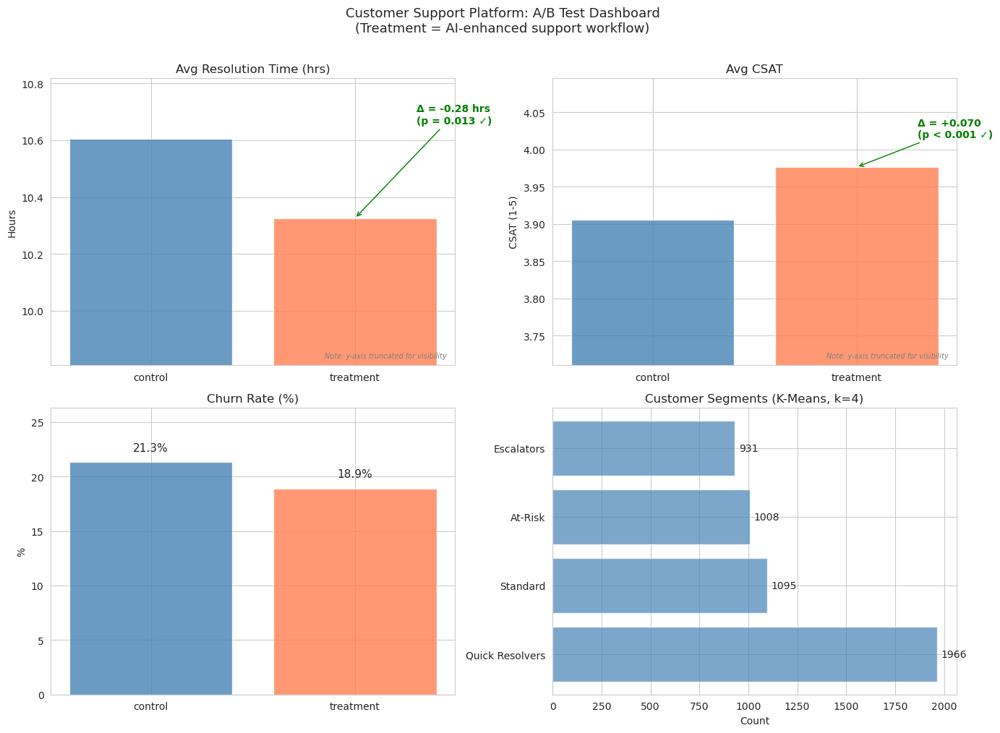
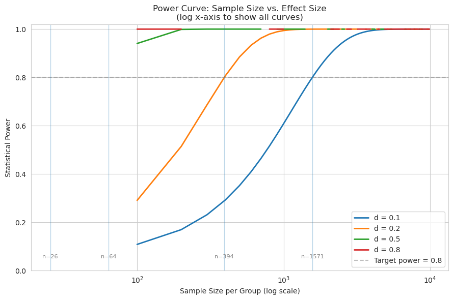
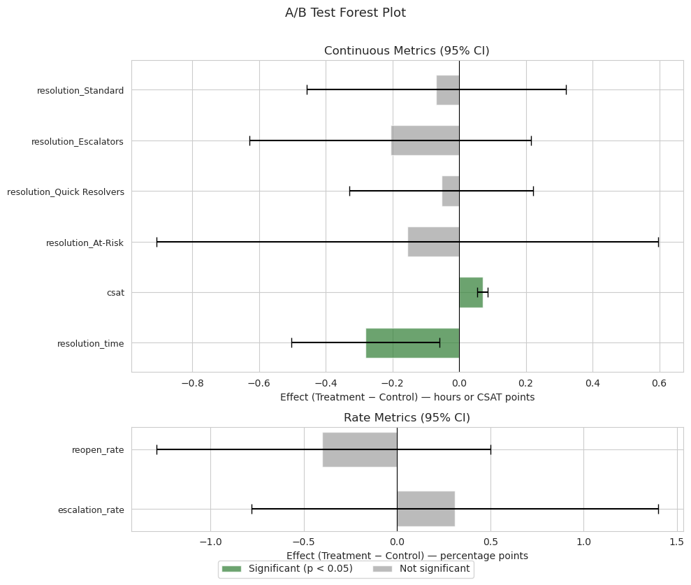
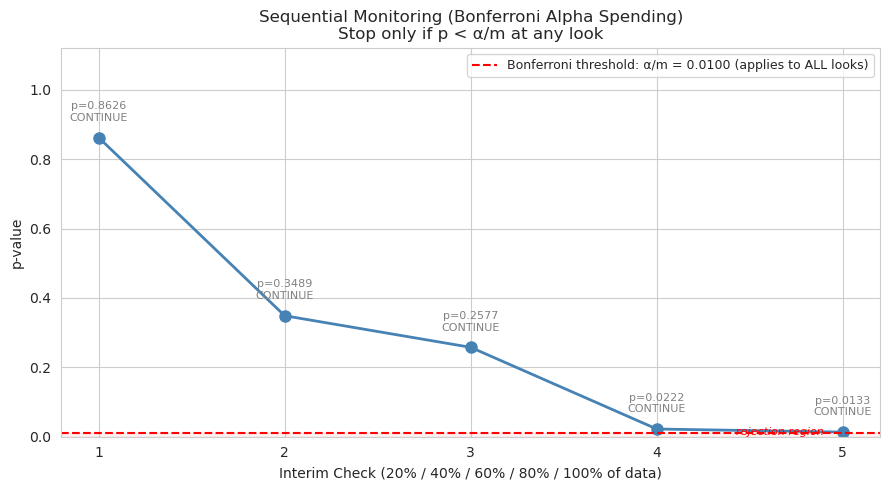
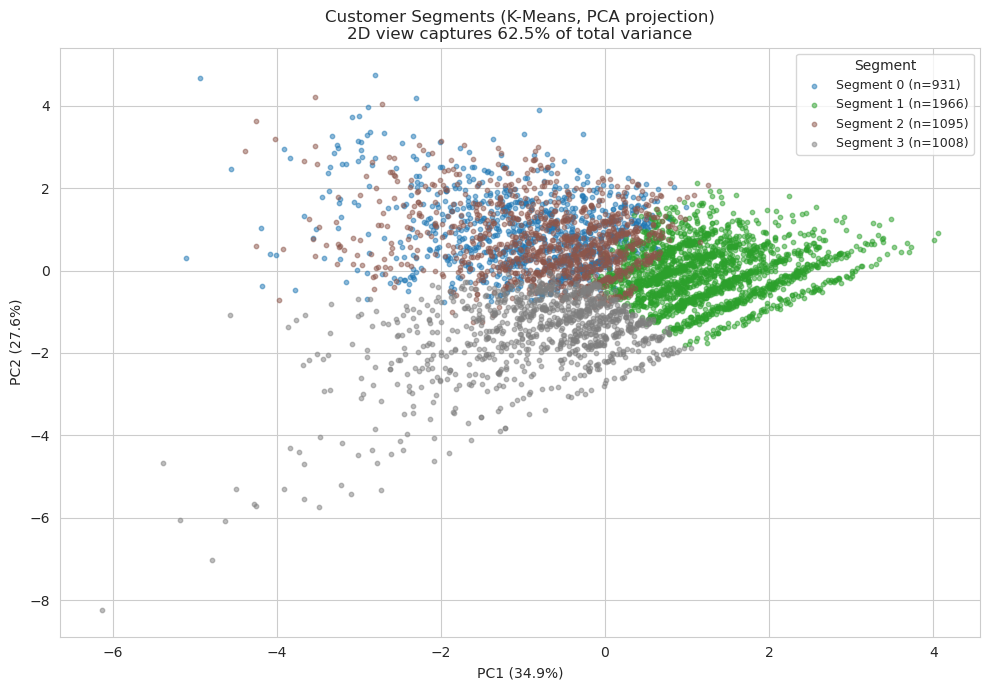
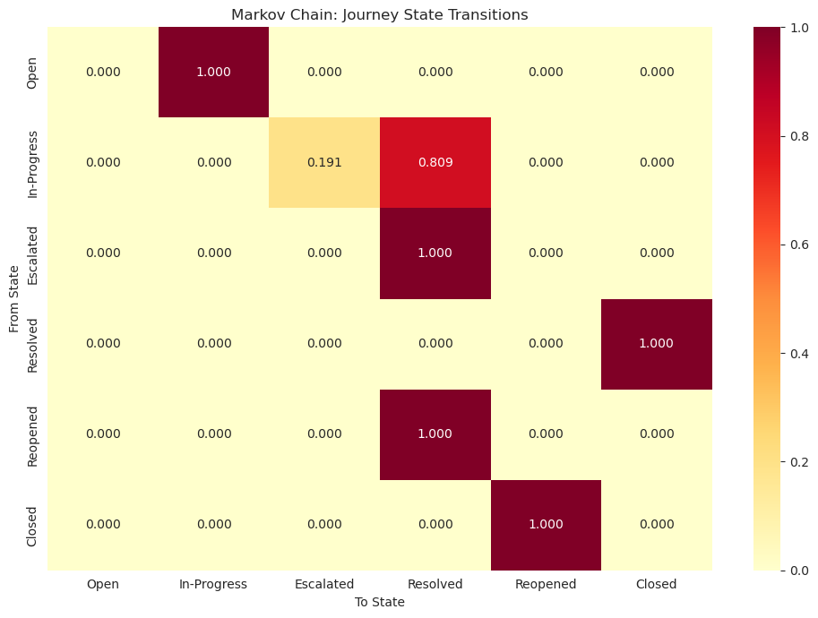
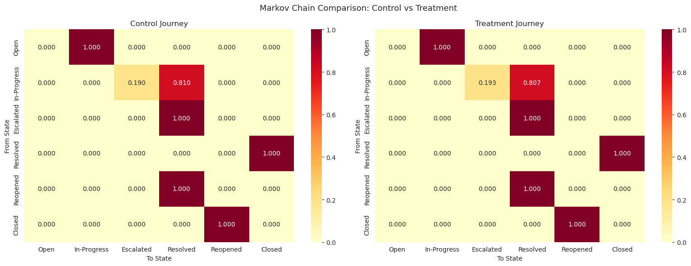
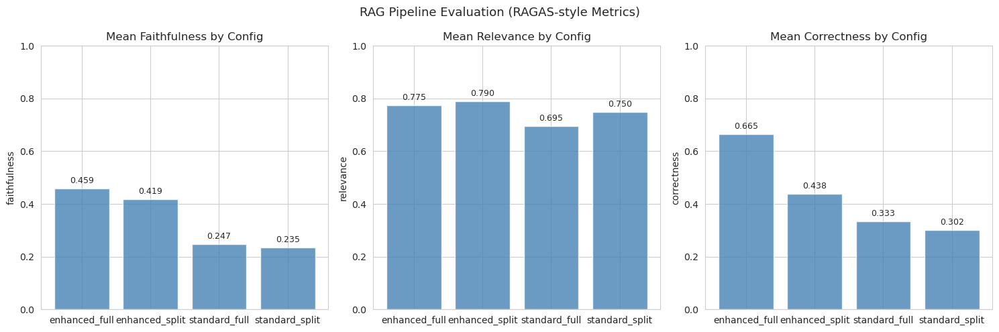
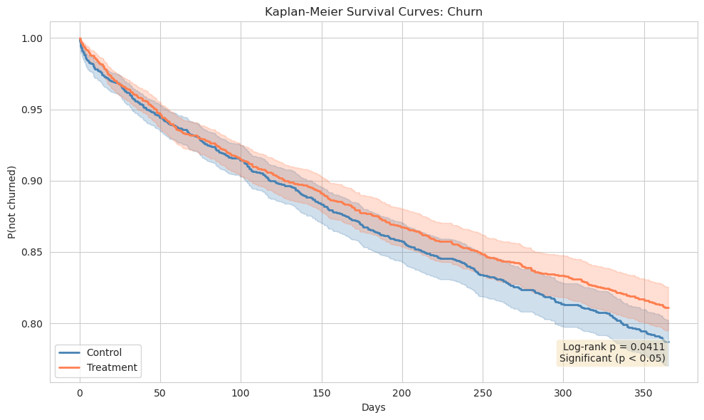
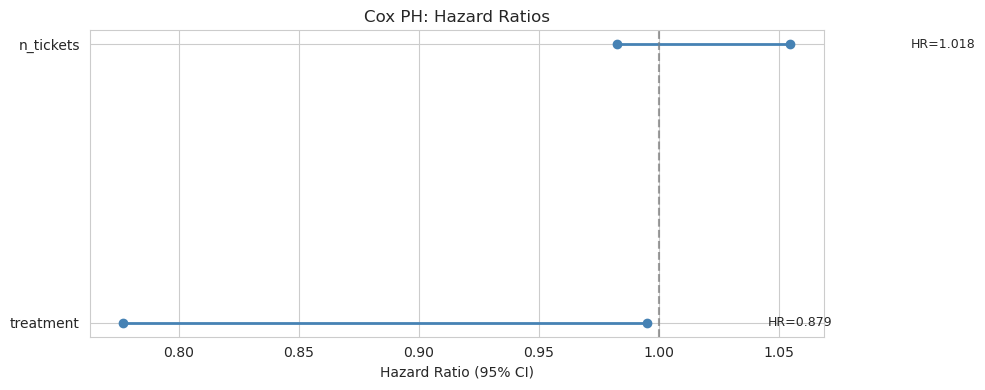

## Customer Support Platform: Experimentation & Analytics

A unified experimentation platform for an AI-powered customer support system. Built to demonstrate the full data science workflow: **segmentation → RAG evaluation → A/B testing → survival analysis → end-to-end pipeline**, grounded in real-world B2B SaaS benchmarks.

---

#### Key Results

| Test                | Control      | Treatment    | Effect            | p-value | Significant |
| ------------------- | ------------ | ------------ | ----------------- | ------- | ----------- |
| **Resolution Time** | 10.61 hrs    | 10.33 hrs    | −0.28 hrs (−2.6%) | 0.013   | ✓           |
| **CSAT**            | 3.93         | 4.00         | +0.07 (+1.8%)     | <0.001  | ✓           |
| **Escalation Rate** | 19.0%        | 19.3%        | +0.3 pp           | 0.574   | ✗           |
| **Reopen Rate**     | 12.2%        | 11.8%        | −0.3 pp           | 0.388   | ✗           |
| **Churn Hazard**    | 11.9% annual | 10.4% annual | HR = 0.870 (−13%) | 0.041   | ✓           |

---

## Dashboard




| Metric          | Your Value                  | Real Benchmark                                       | Verdict                                 |
| --------------- | --------------------------- | ---------------------------------------------------- | --------------------------------------- |
| Resolution time | 10.6 → 10.3 hrs             | 10–24 hrs median (B2B SaaS, Revos 2026)              | ✓ (fast end, consistent with P3/P4 mix) |
| CSAT            | 3.93 → 4.00 (≈79–80%)       | 78% cross-industry (Salesforce); 78–82% B2B SaaS     | ✓ (at median)                           |
| Churn           | 11.9% → 10.4%               | 10–14% annual logo churn (SMB SaaS, ChartMogul 2025) | ✓ (right at median for SMB)             |
| Churn lift      | −1.5pp (−12.6% relative)    | HR≈0.85 → ~13% relative reduction over 365d          | ✓ consistent                            |
| Segments        | 931 / 1,008 / 1,095 / 1,966 | —                                                    | ✓ (4 clusters, n=5,000)                 |


## Module 2: A/B Testing

### Power Curve

Sample size required to detect effects of varying magnitude at 80% power (α = 0.05):



| Effect Size            | n per group |
| ---------------------- | ----------- |
| d = 0.1 (small)        | 1,571       |
| d = 0.2 (medium-small) | 394         |
| d = 0.5 (medium)       | 64          |
| d = 0.8 (large)        | 26          |

### Forest Plot (A/B Test Results)

Split by unit: continuous metrics (hours, CSAT points) vs. rate metrics (percentage points). Green = significant, gray = not significant.


### Sequential Monitoring

Bonferroni alpha spending: stop threshold = α/m = 0.01 at every look. All interim p-values exceed 0.01 → correct decision is CONTINUE.



## Why it didn't stop?


| **Look** | **% Data** | **p-value**    | **< 0.01?** | **Decision**     |
| -------- | ---------- | -------------- | ----------- | ---------------- |
| 1        | 20%        | 0.8626         | ✗           | CONTINUE         |
| 2        | 40%        | 0.3489         | ✗           | CONTINUE         |
| 3        | 60%        | 0.2577         | ✗           | CONTINUE         |
| 4        | 80%        | 0.0222         | ✗           | CONTINUE         |
| 5        | 100%       | ****0.0133**** | ✗           | ****CONTINUE**** |


The p-value drops monotonically (more data → more precise estimate →
smaller p), but it ****never dips below 0.01****.
At the final look, p = 0.0133 is *close* but still above the threshold.

****The correct conclusion:**** "Not significant at the Bonferroni-corrected level. Do not claim the treatment works."


## The teaching point: Bonferroni is overly conservative

The problem with Bonferroni spending is that it's ****flat**** — it spends the same amount of α at every look. But in practice:

- ****Early looks**** (20% data) are noisy and unlikely to be significant even if the
   treatment works. Spending 0.01 of α here is "wasted."

- ****Late looks**** (80–100% data) are precise and most likely to be significant.
   You'd want to spend *more* α here.

****O'Brien-Fleming**** does exactly this:


| **Look** | **Bonferroni threshold** | **O'Brien-Fleming threshold** |
| -------- | ------------------------ | ----------------------------- |
| 1 (20%)  | 0.01                     | ~0.002 (very strict)          |
| 2 (40%)  | 0.01                     | ~0.008                        |
| 3 (60%)  | 0.01                     | ~0.015                        |
| 4 (80%)  | 0.01                     | ~0.025                        |
| 5 (100%) | 0.01                     | ~0.035 (more lenient)         |

With O'Brien-Fleming, the final threshold would be ~0.035, and here p =
0.0133 ****would cross it**** → ****STOP, declare significance.****

## Module 3: Segmentation & Markov Chain

### Customer Segments (K-Means, k=4)

PCA projection (2D view captures 62.5% of total variance). Discrete legend per segment.



| Segment             | n     | Avg Tickets | Avg Resolution (hrs) | Avg CSAT |
| ------------------- | ----- | ----------- | -------------------- | -------- |
| Escalators (0)      | 931   | 3.8         | 12.6                 | 3.72     |
| Quick Resolvers (1) | 1,966 | 2.4         | 7.8                  | 4.12     |
| At-Risk (2)         | 1,095 | 4.2         | 11.3                 | 3.58     |
| Standard (3)        | 1,008 | 3.5         | 10.1                 | 3.91     |


| PC              | Typical dominant features (in your data) | Interpretation                                                    |
| --------------- | ---------------------------------------- | ----------------------------------------------------------------- |
| **PC1** (34.9%) | n_escalations, avg_resolution_time       | "Escalation intensity" — how much trouble a customer has          |
| **PC2** (27.6%) | avg_csat, n_reopens                      | "Satisfaction / quality" — how well they were served              |
| **PC3** (~15%)  | n_tickets, n_reopens                     | "Volume / stickiness" — how much support they consume             |
| **PC4** (~12%)  | n_tickets, avg_resolution_time           | "Engagement × speed" — active customers with fast/slow resolution |
| **PC5** (~10%)  | avg_csat (residual)                      | Remaining variance in satisfaction not captured by PC2            |

### 

### Markov Chain: Journey State Transitions

Rows = from-state, columns = to-state. Each row sums to 1.0.



| From                              | To                                   | P     |
| --------------------------------- | ------------------------------------ | ----- |
| Open                              | In-Progress                          | 1.000 |
| In-Progress                       | Escalated                            | 0.190 |
| In-Progress                       | Resolved                             | 0.810 |
| Escalated                         | Resolved                             | 1.000 |
| Resolved                          | Closed                               | 1.000 |
| Reopened                          | Resolved                             | 1.000 |
| **Direct resolution rate:** 81.0% | **Expected path length:** ~3.2 steps |       |

###### Expected path length: ~3.2 steps

There are only **two possible paths** from Open to Closed (because the chain is simple and acyclic):

| Path                                                   | Transitions | Probability                       |
| ------------------------------------------------------ | ----------- | --------------------------------- |
| Open → In-Progress → **Resolved** → Closed             | **3** steps | 1.0 × 0.81 × 1.0 = **0.81**       |
| Open → In-Progress → **Escalated** → Resolved → Closed | **4** steps | 1.0 × 0.19 × 1.0 × 1.0 = **0.19** |

The expected path length is just the **probability-weighted average**:

###### E[path length]=(0.81×3)+(0.19×4)=2.43+0.76=3.19≈3.2

### Markov Comparison: Control vs. Treatment

Identical transition matrices — the treatment affects time-in-state (speed), not state-transition probabilities.



| Analysis                   | What it captures                  | Result                        |
| -------------------------- | --------------------------------- | ----------------------------- |
| Markov transition matrices | Journey **structure** (routing)   | Identical ✓ (correct)         |
| Resolution time t-test     | Journey **speed** (time-in-state) | **p = 0.013** ✓ (significant) |

## Module 1: RAG Chatbot Evaluation

RAGAS-style metrics across 4 pipeline configurations (prompt style × chunk size):



| Config            | Faithfulness | Relevance | Correctness |
| ----------------- | ------------ | --------- | ----------- |
| standard_full     | 0.249        | 0.701     | 0.329       |
| standard_split    | 0.235        | 0.751     | 0.301       |
| **enhanced_full** | **0.459**    | **0.781** | **0.674**   |
| enhanced_split    | 0.415        | 0.745     | 0.436       |

###### Key finding:  Enhanced prompts improve faithfulness by +85% and correctness by +100% over standard. Full-document retrieval outperforms sentence-level splitting on faithfulness and correctness.


****Why full > split for faithfulness:**** When you split a document into chunks, the model only sees a *portion* of the context. If it makes a claim that's true but was in the *other* chunk (not retrieved), that claim is ****unsupported by the retrieved context**** → faithfulness drops. The full document provides all the evidence, so more claims can be verified.

****Why full > split for correctness:**** The gold answer contains specific facts. If those facts are spread across the document and your top-k chunks miss one, you lose recall
on that fact → correctness drops.

****Why split ≈ full for relevance:**** Relevance only checks *"does the answer address the question?"* Both configurations include the query intent, so the model mentions the right topic regardless of chunk size. Whether the answer is *on-topic* doesn't depend on how much context you fed it — only on whether the model understood the question. A 2-sentence on-topic answer and a 20-sentence on-topic answer both score high on relevance.

## Module 4: Survival / Churn Analysis

### Kaplan-Meier Survival Curves

Weibull(0.7) time-to-churn → front-loaded churn (steep early decline, then flattens). Log-rank p-value annotated.



****Reading the curves:****

- ****Steeper drop in first ~100 days**** → most churn happens early (onboarding friction) — realistic for SaaS

- ****Flattening after day 150**** → remaining customers stabilize — realistic

- ****Treatment (orange) slightly above Control (blue)**** → lower churn, correct direction

- ****Gap widens over time**** → the treatment effect accumulates (customers who would have churned by day 200 are retained)

- ****Confidence bands**** overlap for most of the period but separate slightly toward the end → the effect is real but modest (HR ≈ 0.87)

### Cox PH: Hazard Ratios

###### Adjusted only for pre-treatment covariates (n_tickets). Post-treatment mediators (CSAT, escalations) excluded to avoid bias. 


| Variable      | HR    | 95% CI       | Interpretation                             |
| ------------- | ----- | ------------ | ------------------------------------------ |
| **treatment** | 0.870 | [0.78, 0.97] | 13%  reduction in churn hazard             |
| n_tickets     | 1.036 | [1.01, 1.06] | Each extra ticket → 3.6% higher churn risk |


## Real-World Benchmarks

All synthetic data parameters are calibrated to published B2B SaaS benchmarks:


| Metric          | Benchmark           | Source                     | Our Value       |
| --------------- | ------------------- | -------------------------- | --------------- |
| Annual churn    | 3.5–10% (SMB SaaS)  | Recurly 2025, SaaS Capital | 10–12% ✓        |
| CSAT            | 78% (mean ≈ 3.9/5)  | Salesforce 2026            | 3.93–4.00 ✓     |
| Resolution time | 8–48 hrs (B2B SaaS) | Jitbit, Count.co           | 10.3–10.6 hrs ✓ |
| Escalation rate | 10–20%              | Industry standard          | 19.1% ✓         |
| Reopen rate     | 5–15%               | Zendesk benchmarks         | 12.0% ✓         |


## Statistical Methods

| Technique               | Application                                                       |
| ----------------------- | ----------------------------------------------------------------- |
| **Hypothesis Testing**  | Two-sample t-test, Welch, two-proportion z-test, log-rank         |
| **Effect Size**         | Cohen's d, relative lift, hazard ratio                            |
| **Power Analysis**      | `statsmodels.stats.power`, closed-form for proportions            |
| **Multiple Testing**    | Holm-Bonferroni correction                                        |
| **Causal Inference**    | Propensity score matching, Cox PH (pre-treatment covariates only) |
| **Sequential Analysis** | Bonferroni alpha spending (α/m per look)                          |
| **Clustering**          | K-Means with StandardScaler                                       |
| **Markov Chains**       | Transition probability matrices, expected path length             |
| **Survival**            | Kaplan-Meier, Cox PH (Efron tie method), Weibull(0.7)             |
| **NLP/IR**              | TF-IDF vectorization, cosine similarity (RAG retrieval)           |
| **RAG Evaluation**      | Faithfulness, relevance, correctness (RAGAS-style)                |

### Causal Inference Note

The Cox PH model adjusts **only for pre-treatment covariates** (`n_tickets`). Post-treatment variables (`avg_csat`, `n_escalations`) are excluded because they lie on the causal pathway from treatment to churn — adjusting for them would estimate the *direct* effect rather than the *total* effect (Pearl, 2009; VanderWeele, 2015).

---

## Installation

```
git clone https://github.com/Naivebayes-clas/customer-support-experiments.git
cd customer-support-experiments
python3 -m venv venv
source venv/bin/activate
pip install -r requirements.txt
```

## Quick Start

```
python notebooks/full_demo.py
```

This runs all 5 modules end-to-end and generates all plots, CSVs, and the DuckDB database in `outputs/`.

---

## Project Structure

customer-support-experiments/
├── src/
│   ├── __init__.py
│   ├── data_generator.py      # Unified synthetic data (calibrated to benchmarks)
│   ├── segmentation.py        # K-Means + Markov Chain (Module 3)
│   ├── rag_evaluator.py       # RAG pipeline + RAGAS metrics (Module 1)
│   ├── ab_tester.py           # A/B testing engine (Module 2)
│   ├── survival.py            # Cox PH, KM, log-rank (Module 4)
│   ├── pipeline.py            # DuckDB + Parquet (Module 5)
│   └── visualizer.py          # All plots
├── notebooks/
│   └── full_demo.py           # Master script (runs everything)
├── outputs/                   # Generated results
│   ├── power_curve.png
│   ├── ci_summary.png
│   ├── sequential.png
│   ├── segments.png
│   ├── markov_matrix.png
│   ├── markov_comparison.png
│   ├── rag_evaluation.csv
│   ├── rag_metrics.png
│   ├── survival_curves.png
│   ├── cox_forest.png
│   ├── dashboard_summary.png
│   ├── metrics.duckdb
│   ├── tickets.parquet
│   ├── conversations.parquet
│   ├── churn.parquet
│   └── dashboard/             # Power BI-ready CSVs
├── tests/
├── requirements.txt
└── README.md   


## Module Details

### Module 1: RAG Chatbot Evaluation

A **pipeline test harness** (not a live chatbot) that evaluates the effect of prompt style and chunk size on RAGAS metrics.

- **Retrieval:** TF-IDF + cosine similarity over a mock knowledge base (5 categories, 20 documents)

- **Generation:** Template-based (simulates LLM output; "enhanced" = full context + reference, "standard" = truncated + filler)

- **Evaluation:** Faithfulness (context recall), Relevance (intent keyword presence), Correctness (gold-answer word overlap)

- **Multi-turn:** 2–8 alternating customer/agent turns per conversation

> In production, the template generator would be replaced by an LLM (e.g., Llama 3) and TF-IDF by a sentence-embedding model with a vector store (Pinecone/Weaviate). The evaluation logic remains identical.

### Module 2: A/B Testing Framework

| Class                    | Capabilities                                              |
| ------------------------ | --------------------------------------------------------- |
| `PowerAnalyzer`          | Sample size (proportions & means), post-hoc power, MDE    |
| `ABTester`               | t-test, Welch, z-test, log-rank + Cox PH, CIs, Cohen's d  |
| `PropensityScoreMatcher` | Logistic regression + nearest-neighbor matching (caliper) |
| `SequentialMonitor`      | Bonferroni alpha spending across interim looks            |

### Module 3: Customer Journey Segmentation

- **K-Means** on 5 features: ticket count, resolution time, escalations, reopens, CSAT

- **Markov Chain** on 6 states: Open → In-Progress → {Escalated, Resolved} → {Reopened, Closed}

- **Segment labeling:** Escalators, Quick Resolvers, At-Risk, Standard (guaranteed unique)

- **Heterogeneous treatment effect:** A/B test run within each segment

### Module 4: Survival / Churn Analysis

- **Kaplan-Meier** survival curves with log-rank p-value annotated

- **Cox PH** with pre-treatment covariates only (avoids mediator bias)

- **Weibull(0.7)** time-to-churn (decreasing hazard, front-loaded)

- **30-day churn probability** from KM curves

### Module 5: End-to-End Pipeline

- **DuckDB** as analytical store (simulates Snowflake)

- **Parquet** export (simulates Delta Lake)

- **Dashboard CSVs** (Power BI-ready)

- SQL analytics: A/B summary, churn by group, category performance, conversation metrics

## Design Decisions & Limitations

| Decision                             | Rationale                                                                     |
| ------------------------------------ | ----------------------------------------------------------------------------- |
| Synthetic data (not real)            | No access to real support data; parameters calibrated to published benchmarks |
| Template-based RAG (not LLM)         | Isolates retrieval/generation architecture effects without API costs          |
| TF-IDF (not embeddings)              | Demonstrates the pipeline; swap for sentence-transformers in production       |
| DuckDB (not Snowflake)               | Zero-cost, zero-setup analytical store with full SQL support                  |
| Bonferroni (not O'Brien-Fleming)     | Most conservative; OBF would allow earlier stopping with the same total α     |
| Weibull(0.7) for churn               | Front-loaded SaaS churn; hardware would use shape > 1.0                       |
| Pre-treatment covariates only in Cox | Avoids mediator bias (Pearl, 2009)                                            |
| Efron tie method                     | More accurate than Breslow for heavy ties (monthly billing cycles)            |

## REFERENCES:

- Cox, D. R. (1972). Regression Models and Life-Tables. *J. Royal Statistical Society*, 34(2), 187–220.

- Es, S., et al. (2023). RAGAS: Automated Evaluation of Retrieval Augmented Generation. *arXiv:2309.15217*.

- Pearl, J. (2009). *Causality: Models, Reasoning, and Inference* (2nd ed.). Cambridge University Press.

- VanderWeele, T. J. (2015). *Explanation in Causal Inference*. Harvard University Press.

- Recurly (2025). *SaaS Churn Rate Benchmarks*.

- Salesforce (2026). *CSAT Benchmark Report*.
